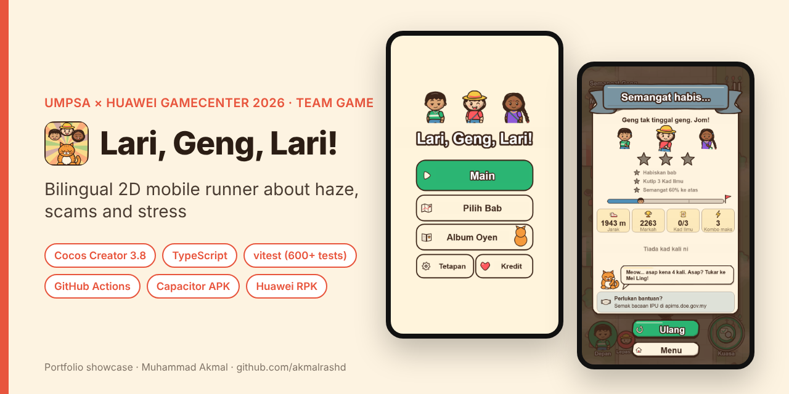
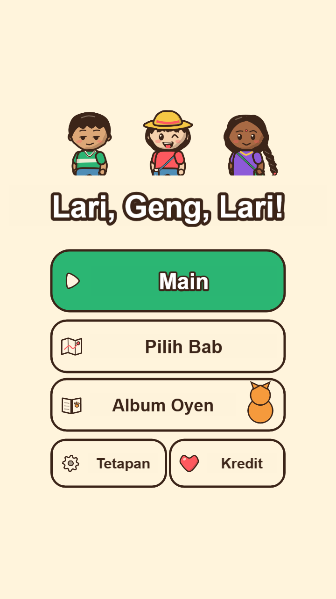
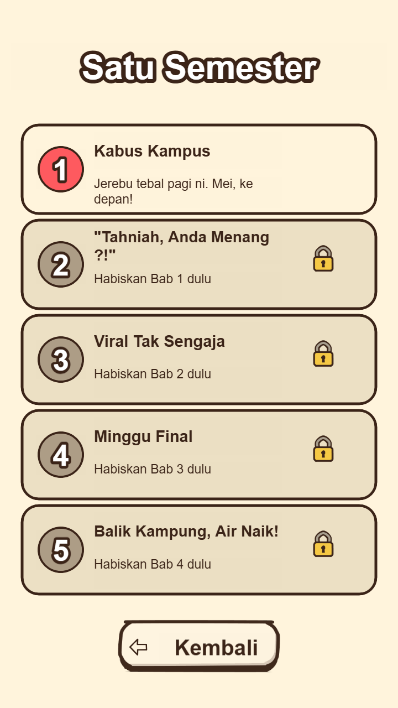
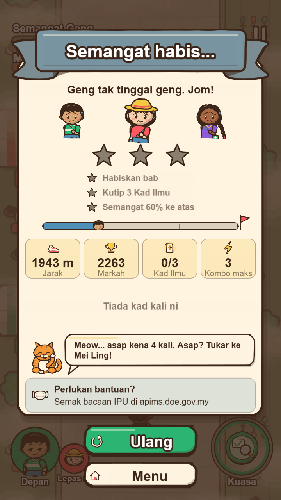
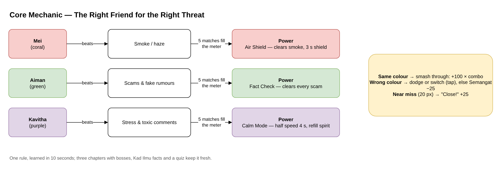
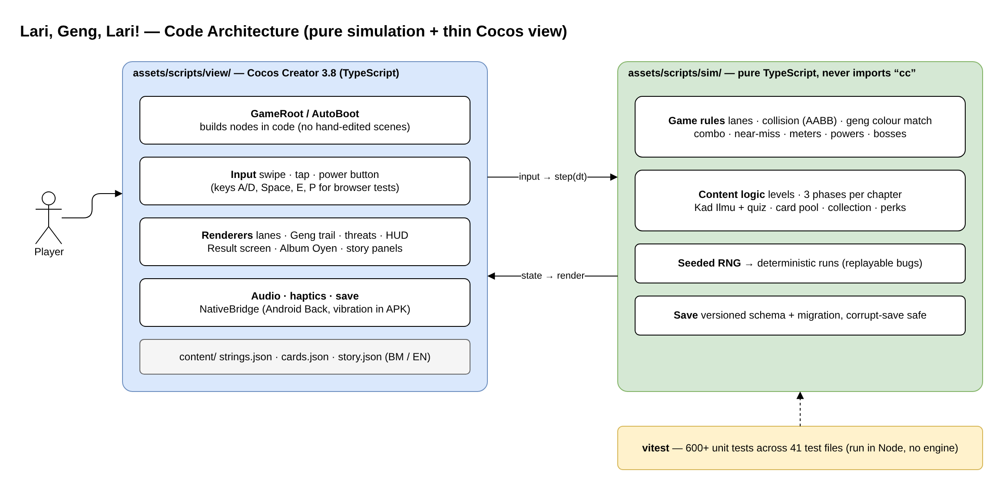
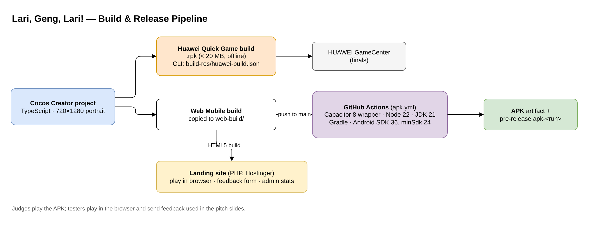

# Lari, Geng, Lari! (Run, Gang, Run!): 2D Mobile Game

> **Portfolio showcase.** The game repository is private while the competition is running. This page shows the design, architecture and my part.

🎮 **Play now:** [larigenglari.prsdntworldwide.com](https://larigenglari.prsdntworldwide.com) (runs in the browser, best on a phone)  
**Competition:** 5th UMPSA × HUAWEI GameCenter Mobile App Competition 2026 (UXHMAC 2026), Category B  
**Type:** Student team project · **Period:** October 2026 – present

     

---

## The game

Three housemates, **Aiman, Mei and Kavitha**, run through one university semester. Threats fall down three lanes, and **each threat can only be beaten by the friend of the same colour**: Mei beats haze, Aiman beats scams, Kavitha beats stress. You swipe between lanes and tap to switch who runs in front. Between the action, *Kad Ilmu* (fact cards) teach real tips about haze, online scams and mental health, followed by a quick quiz.

- Bilingual: **Bahasa Melayu and English**, switchable in settings
- Chapters with rising difficulty, bosses, combo and near-miss rewards, 3-star results
- Collectible card album, story panels, pause and resume that survive interruptions
- Works **offline**; save data is versioned and safe against corruption
- **Live site** with in-browser play and a feedback form: [larigenglari.prsdntworldwide.com](https://larigenglari.prsdntworldwide.com)

  
  
  

## System design

Editable draw.io sources are in [`docs/diagrams`](docs/diagrams).

### Core mechanic

### Code architecture: pure simulation + thin Cocos view

### Build and release pipeline

## Engineering highlights

- **All game rules live in a pure TypeScript simulation** (`sim/`) that never imports the engine. The Cocos layer only renders state and forwards input, so the rules are fully unit-tested in Node.
- **600+ vitest tests** across 41 test files cover collision, matching, combo, bosses, card pool, save migration and more.
- **Seeded random generator**: every run can be replayed exactly, which makes bugs reproducible.
- **Two release targets from one project**: a Huawei Quick Game `.rpk` and an Android APK built automatically by **GitHub Actions** (Capacitor wrapper), plus a browser build on a small PHP landing site with a feedback form.
- Content (strings, cards, story) is data in JSON with a checker script, so text can change without touching code.

## AI disclosure

The competition allows AI if it is disclosed, and we follow the same rule here:
- **Code:** written with an AI coding assistant (Claude Code), reviewed and play-tested by the team.
- **Art:** AI-assisted SVG drawn to our own palette and style rules, checked by the team.
- **Audio:** procedural sound effects generated by script.
- **Text and slides:** AI drafts edited by us; facts checked against news sources and official sites.
- **Ours:** the game idea, characters, chapter choice, playtesting, device testing, builds and pitching.

## Contact

**Muhammad Akmal bin Mohd Rashid**: Software Engineering student, UMPSA.  
Open to a 6-month internship (22 February to 7 August 2027).  
📧 work.akmalrashd@gmail.com · 💼 [linkedin.com/in/akmalrashd](https://www.linkedin.com/in/akmalrashd)
